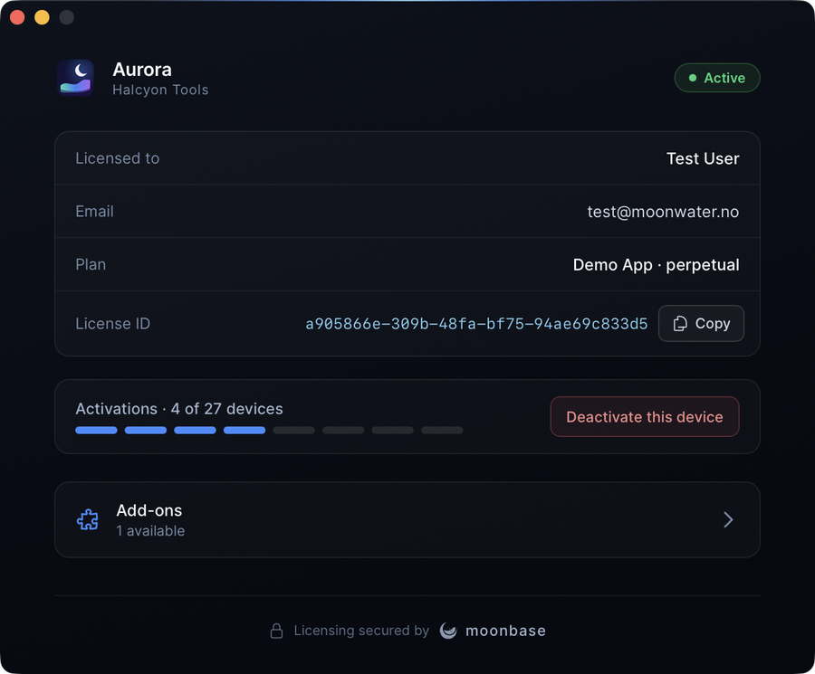

# Moonbase Rust Activation SDK

License activation for desktop apps, in Rust: a core SDK crate, and a Tauri plugin
that drops a finished, themeable activation window into a Tauri app.

[](.github/workflows/ci.yml)
[](https://www.rust-lang.org)
[](https://tauri.app)
[](#pick-your-path)
[](LICENSE)

Ship a paid app and you need the same four things: let a customer unlock it, keep it
unlocked offline, tie the seat to a machine, and hand the seat back when they move.
This repo is those four things for Rust. It is the Rust counterpart of
[moonbase-cpp](https://github.com/Moonbase-sh/moonbase-cpp), with the same behaviour,
the same error model and the same cross-SDK device id.

<p align="center">
  
  
</p>
<p align="center"><em>The Tauri plugin's activation window, branded for the example app and activated against Moonbase's demo store.</em></p>

## What's in this repo

| | What it is | Where |
| --- | --- | --- |
| **`moonbase`** | The core SDK: activation, polling, local RS256 validation, offline licenses, revocation, trials, update checks, pluggable storage and HTTP. No framework. | [`crates/moonbase/`](crates/moonbase/) |
| **`tauri-plugin-moonbase`** | A Tauri 2 plugin built on the core: a themeable activation window from the "Solstice Activation" design (the same one the JUCE module uses), an activation controller with commands and a state event, and Rust-side feature gating. | [`crates/tauri-plugin-moonbase/`](crates/tauri-plugin-moonbase/) |
| **Aurora** | A Tauri example app using the plugin's window, wired to Moonbase's public demo store so it activates out of the box. | [`examples/tauri-app/`](examples/tauri-app/) |

## Pick your path

| | `moonbase` crate | `tauri-plugin-moonbase` |
| --- | --- | --- |
| **Form** | Library crate, blocking API | Tauri 2 plugin |
| **Built-in UI** | No | Yes, themeable: its own window, or an overlay that locks the app until it is licensed; or turn it off and drive your own from the state event |
| **Best for** | CLI tools, egui/iced/Slint apps, servers of your own, anything not Tauri | Tauri apps |
| **Guide** | [`docs/core-sdk.md`](docs/core-sdk.md) | [`docs/tauri.md`](docs/tauri.md) |

Both compute the same [device id](docs/device-identity.md) as every other Moonbase SDK,
so a license activated through any of them validates in the others.

## Quick start

### Core SDK

```toml
[dependencies]
moonbase = { git = "https://github.com/Moonbase-sh/moonbase-rs", tag = "v0.1.0" }
```

```rust
use moonbase::{ActivationMethod, FileLicenseStore, Licensing, LicensingOptions};

let licensing = Licensing::builder(LicensingOptions::new(
    "https://your-tenant.moonbase.sh",
    "your-product",
    PUBLIC_KEY_PEM,
))
.store(FileLicenseStore::new(license_path))
.build()?;

let request = licensing.request_activation(ActivationMethod::Online)?; // send the user to request.browser_url
```

Then `complete_activation(&request)` until it lands, which stores the license, and at
the next launch `load_and_validate()`: [core SDK guide](docs/core-sdk.md).

### Tauri plugin

```rust
tauri::Builder::default()
    .plugin(tauri_plugin_opener::init())
    .plugin(
        tauri_plugin_moonbase::Builder::new(ENDPOINT, PRODUCT_ID, PUBLIC_KEY)
            .ui(UiConfig::new().product_name("Solstice").manufacturer_name("Helio Audio").accent("#186cdc"))
            .build(),
    )
```

That is the whole integration: the activation window presents itself whenever the app
is locked. To lock the app itself rather than open a window beside it, add
`.presentation(Presentation::overlay())`: the same screens then cover the app's window
until it is licensed. Gate paid features in Rust with `app.moonbase().is_licensed()`,
and open the UI from a menu or button with
`app.moonbase().present(Some(Screen::License))`: [Tauri guide](docs/tauri.md).

### Run the example

```sh
cargo run -p aurora
```

It opens against `demo.moonbase.sh`, where you can start a trial or activate in the
browser. See [`examples/tauri-app/`](examples/tauri-app/).

## What you get

- **Browser activation.** The app asks for a request, opens a URL, and polls. No
  serial numbers to type, no keyfiles to email.
- **Offline activation.** Mint an offline license through the normal browser flow,
  or, on a machine with no network at all, exchange a device token file for a license
  file. Both produce a permanent, locally validated license.
- **Local-first validation.** Signature, audience, issuer, device and expiry are
  checked in-process. The API is contacted at most every few minutes, and a
  configurable grace period keeps an app working through an outage.
- **Cross-SDK device identity.** A SHA-256 of stable native hardware identifiers,
  per the shared fingerprint spec, verified against its conformance vectors and
  against `@moonbase.sh/licensing` on real hardware. No subprocess, no root-only file.
- **Trials, seats and entitlements.** Trial state, seat counts, expiry, sub-product
  ownership and custom properties arrive on the validated license.
- **Add-ons.** Sub-products the store includes in a license unlock with it, seat by
  seat. The SDK takes a seat of one, starts its trial, and lists the product's add-ons
  with prices, ownership and trial status; the Tauri plugin has a screen for them.
- **Licenses that cover some versions.** A license with limited updates ("12 months of
  updates", "up to 2.x") is judged against the running version, as Moonbase and every
  other SDK judge it, and refused with what it covers and where to upgrade. The Tauri
  plugin locks on an "Upgrade needed" screen and keeps the license.
- **Update checks.** The license says which release is current; the SDK fetches its
  notes and a download link the license is entitled to.
- **Safe across processes.** Instances sharing a license file take turns on online
  checks, so ten app windows make one request, and a license written by one is never
  read half-written by another.

## Documentation

| | |
| --- | --- |
| [Core SDK](docs/core-sdk.md) | Activation, validation, the grace period, licenses that cover some versions, revocation, add-ons, offline licenses, errors, custom storage and transports, mapping from moonbase-cpp |
| [Tauri plugin](docs/tauri.md) | Setup, the activation window and its theming, locking the app, the state model, commands and events, gating, add-ons, licenses that cover some versions, offline activation, updates |
| [Device identity](docs/device-identity.md) | What the device id is made of, failure modes, diagnostics |
| [Security](docs/security.md) | What the SDK guarantees, what it leaves to you, and how to gate well |
| [Contributing](CONTRIBUTING.md) | Build, test, conformance vectors, CI |

## Security

The SDK answers one question soundly: is this license valid, for this product, on this
machine, right now? It deliberately ships no anti-debugging, obfuscation or tamper
detection, because anything general enough to live in an open-source crate is
identical in every app using it. Hardening belongs in your binary.
[How to do it well](docs/security.md).

## License

Released under the [MIT License](LICENSE).
