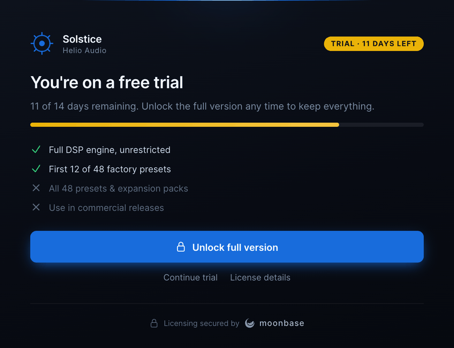
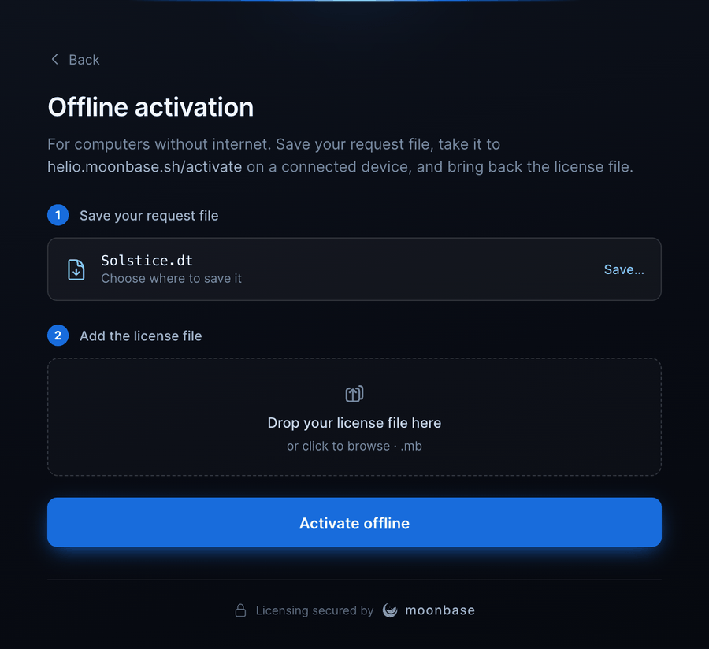
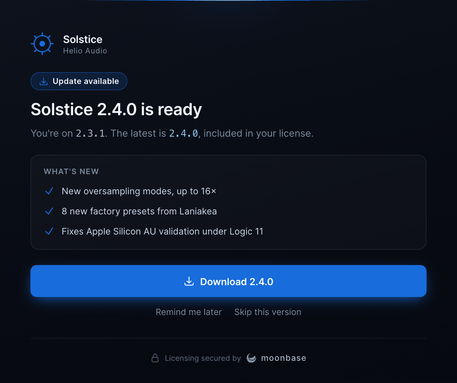
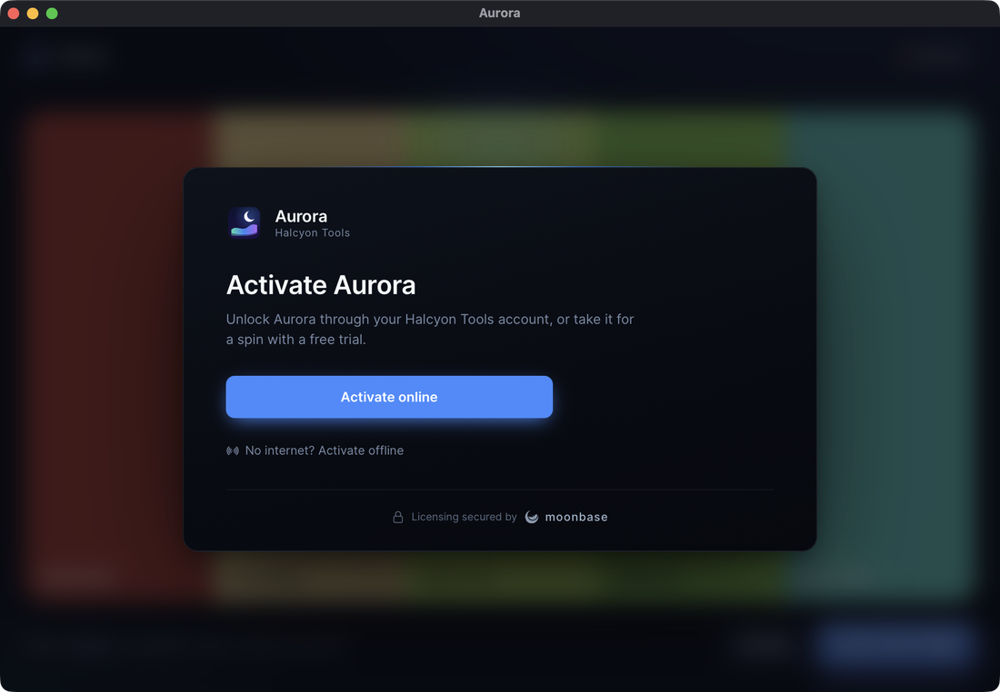
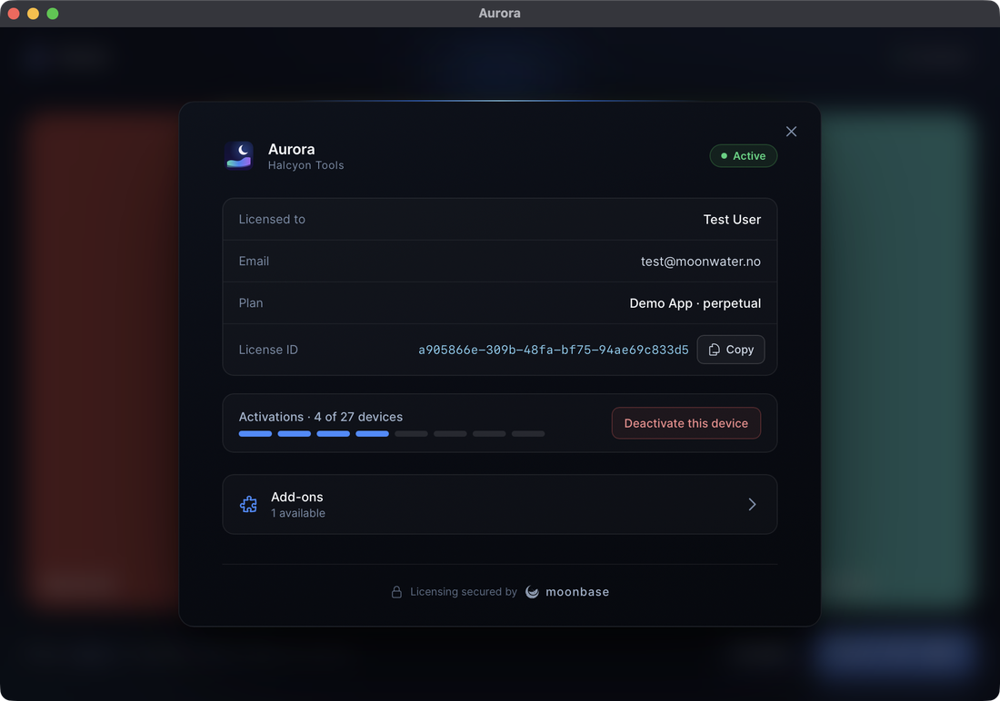
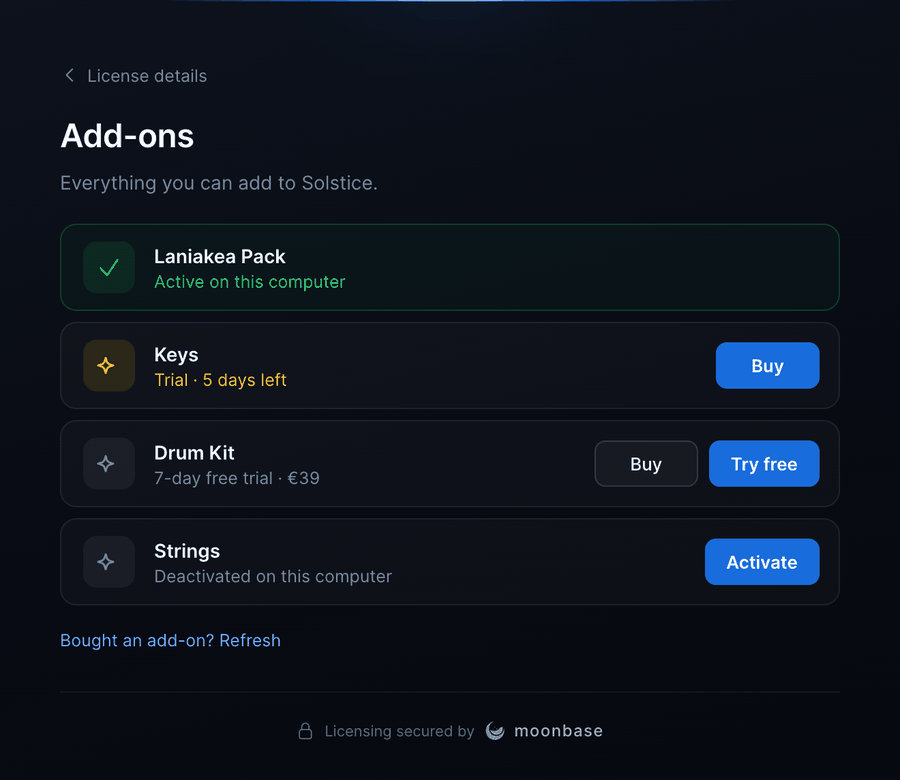
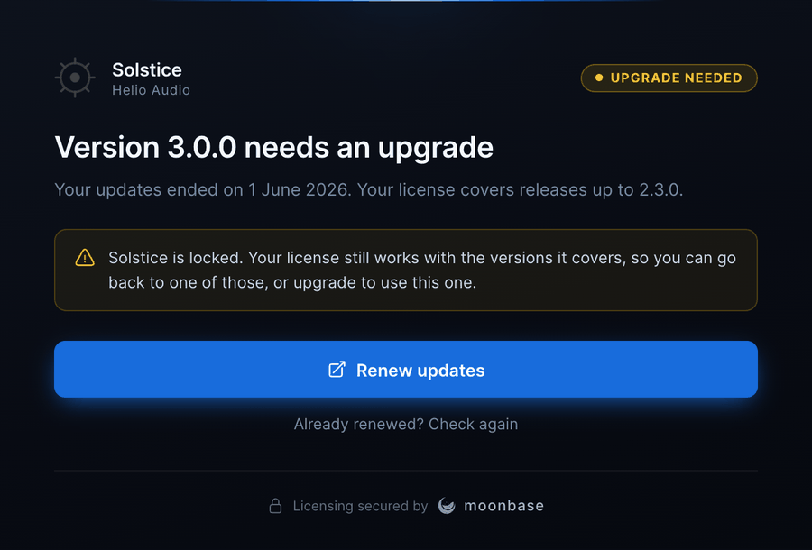

# Tauri plugin: `tauri-plugin-moonbase`

The plugin at [`crates/tauri-plugin-moonbase/`](../crates/tauri-plugin-moonbase/)
brings Moonbase licensing to a Tauri 2 app, the counterpart of moonbase-cpp's JUCE
module. It validates the stored license at startup, runs browser and offline
activation, trials, deactivation, add-ons and update downloads, locks (and offers the
upgrade) when a license doesn't cover the running version, watches for expiry and for
other instances, and ships a finished, themeable activation UI built from the "Solstice
Activation" design: in its own window, or over the app's window, locking it until it is
licensed. Register the plugin and the UI presents itself whenever the app is locked: no
frontend code required. Prefer your own UI? Turn it off and drive yours from the same
state event and commands.

<p align="center">
  
  
</p>

## Setup

```toml
# src-tauri/Cargo.toml
[dependencies]
tauri-plugin-moonbase = "0.1"
tauri-plugin-opener = "2"
```

```rust
// src-tauri/src/lib.rs
const PUBLIC_KEY: &str = include_str!("../moonbase-public-key.pem");

tauri::Builder::default()
    .plugin(tauri_plugin_opener::init())
    .plugin(
        tauri_plugin_moonbase::Builder::new("https://your-tenant.moonbase.sh", "your-product", PUBLIC_KEY)
            .account_id("your-account-id") // optional issuer pin
            .build(),
    )
    .run(tauri::generate_context!())?;
```

```json
// src-tauri/capabilities/default.json
{ "permissions": ["core:default", "opener:default", "moonbase:default"] }
```

`moonbase:default` grants every command an activation UI needs. `moonbase:read-only`
grants only `state`, `device`, `check_update` and `present`, for windows that should
show the license, and open the activation window, but not change it. Every permission
is listed in the
[permission reference](../crates/tauri-plugin-moonbase/permissions/autogenerated/reference.md).

Registering the opener plugin is optional: the plugin opens the browser through it when
it is there (which also covers mobile), and through the desktop default browser when it
is not. Registering `tauri-plugin-dialog` too gives the offline flow a native "Save"
dialog for the machine file; without it, the file goes to Downloads and is revealed.

## The activation window

On by default. Brand it with a [`UiConfig`](../crates/tauri-plugin-moonbase/src/ui.rs):

```rust
use tauri_plugin_moonbase::UiConfig;

tauri_plugin_moonbase::Builder::new(ENDPOINT, PRODUCT_ID, PUBLIC_KEY)
    .ui(UiConfig::new()
        .product_name("Solstice")
        .manufacturer_name("Helio Audio")
        .accent("#186cdc")
        .logo_svg(include_str!("../icons/logo.svg"))
        .trial_feature("Full DSP engine, unrestricted", true)
        .trial_feature("Use in commercial releases", false)
        .show_addons(true))
    .build()
```

| `UiConfig` | Default | |
| --- | --- | --- |
| `product_name` | the app's `productName` | Shown throughout |
| `manufacturer_name` | none | Under the product name, and as the account the customer signs in to |
| `accent` | `#186cdc` (Moonbase blue) | The one brand colour: buttons, progress, step numbers. Any CSS colour |
| `logo_svg`, `logo_png` | a sun mark in the accent | The product mark in the header |
| `trial_feature(label, included)` | none | The trial screen's included / excluded list |
| `trial_length_days` | 14 | Shown when the license does not say |
| `show_addons` | off | An "Add-ons" row in the license details, opening the [add-ons screen](#add-ons) |
| `strings(UiStrings)` | built-in copy | Override any heading or body, including the per-reason lock copy |
| `show_moonbase_badge` | on | The "Licensing secured by moonbase" footer, with the Moonbase mark linking to moonbase.sh |
| `auto_present_on_lock` | on | Present the window when the app starts unlicensed, and whenever the license is lost |
| `auto_present_update` | on | Present the update screen when the app starts with a newer, unskipped release |
| `reduce_motion` | off | Skip transitions; the system setting is honoured either way |
| `window_title` | the product name | |
| `presentation` | `Presentation::Window` | Its own window, or an overlay that locks one of the app's windows; [see below](#locking-the-app) |
| `UiConfig::disabled()` | | No built-in UI: build your own on the state event |

Show it yourself from Rust or the frontend, optionally on a particular screen:

```rust
use tauri_plugin_moonbase::Screen;

app.moonbase().present(Some(Screen::License))?; // License, Update, Offline, AddOns, or None
```

```js
await window.__TAURI__.moonbase.present({ screen: 'license' })
```

The screens, all driven by the license state:

- **Welcome**: activate online, or offline. Once the app has lost its license, it says
  why (deactivated, expired, no longer valid, or unverified for too long).
- **Waiting for activation**: the browser is open; a device chip, the link to open again,
  "Browser didn't open? Copy the link", and Cancel. When the browser can't be opened at
  all (no default browser set, say), the screen says so and makes copying the link its
  main action, so the customer can finish in any browser, on this computer or another.
- **You're all set**: a success moment with a mini license card.
- **Offline activation**: save the machine file, then drop or pick the license file the
  customer got back.
- **Trial** and **Trial expired**: days left, the feature list, and Unlock.
- **Upgrade needed**: a license that doesn't cover this version of the app. It says
  what the license covers and offers the upgrade; see
  [Licenses that cover some versions](#licenses-that-cover-some-versions).
- **License details**: who it is licensed to, the plan and expiry, the license id with a
  Copy button for support, seats used, and Deactivate.
- **Add-ons** (with `show_addons`): the product's add-ons from Moonbase, each with
  where it stands on this computer and a Try free, Buy or Activate action. See
  [Add-ons](#add-ons).
- **Update available**: the release notes, a Download button that saves the installer
  for this platform with progress and reveals it, and Skip this version (remembered in
  `<license>.state.json`, so a newer release still prompts). For a new version the
  customer's license doesn't cover, it offers the upgrade instead and says what the
  license covers.

<p align="center">
  
  
  
</p>

### Locking the app

By default the activation UI is a separate window and the app stays usable beside it,
which suits an app with free features. To lock the app instead, present the UI as an
overlay over one of its windows:

```rust
use tauri_plugin_moonbase::{Presentation, UiConfig};

.ui(UiConfig::new().product_name("Solstice").presentation(Presentation::overlay()))
// or Presentation::overlay_on("editor") for a window not labelled "main"
```

The same screens then float over the app's own content, which is blurred, dimmed and
inert behind them: no clicks, no focus, and none of the app's keyboard shortcuts. While
the app has no license the overlay cannot be dismissed. Once it is licensed (the
customer activated, or a trial started) it gets a close button, closes on Escape, and
opens again from `present` like the window does.

<p align="center">
  
  
</p>

How the overlay works: the plugin adds a dormant script to the app's webviews and mounts
the UI on demand in a closed shadow root, so the app's styles cannot reach the UI and
its styles cannot reach the app. It works under a strict content security policy:
styles are applied through a constructed stylesheet, and an SVG logo is inlined. A PNG
logo is passed as a `data:` URL, so allow `img-src data:` if you use one. The overlay
survives a reload of the page. It locks only the window it is on, so present it over
the window your app does its work in. In this mode the offline screen offers a file
picker rather than drag and drop, since an app window usually handles dropped files
itself.

Keep gating in Rust either way. The overlay is a lock on the interface; the check that
counts is `is_licensed()` in the commands that do the paid work.

### How the window is built

The plugin serves the window's page itself over its own `moonbase://`
scheme (`http://moonbase.localhost` on Windows), with a strict content security policy,
and grants that one window (or, for an overlay, the window it locks) the plugin's
commands with a capability added at runtime, so your capability files need no changes
for it. The window is 660 points wide, sizes itself to
each screen, and is a child of your `main` window when there is one.

There is deliberately no separate "Start free trial" button: Moonbase starts trials in
the same browser flow as purchases, so "Activate online" covers both.

### Builder options

| Option | Default | |
| --- | --- | --- |
| `account_id` | none | Pin the token issuer |
| `application_version` | the app's version from `tauri.conf.json` | Reported to Moonbase, compared with the latest release, and the version a [license that covers some versions](#licenses-that-cover-some-versions) has to cover |
| `enforce_release_access` | on | Judge that on this device too when Moonbase isn't asked; Moonbase judges it either way |
| `auto_activate_sub_products` | on | Take a seat of each [add-on](#add-ons) the customer owns on every activation and check |
| `license_file` | `<app data dir>/license.mb` | Where the license is kept |
| `grace_period` | 7 days | How long a license works without a successful online check |
| `check_interval` | 5 minutes | The least time between online checks |
| `http_timeouts` | 10 s connect, 30 s total | |
| `client_info` | none | An extra `User-Agent` segment for a layer on top of the plugin |
| `metadata` | none | Sent as `meta[<key>]` with license requests |
| `device_id_resolver` | the cross-SDK fingerprint | See [device identity](device-identity.md); the resolver itself, or an `Arc` of one |
| `allow_device_name_fallback` | off | Accept a host-name id (`mbd2n_`) where no hardware identity is readable |
| `transport` | the bundled transport | Route requests through your own `HttpTransport`, itself or an `Arc` of one |
| `open_browser` | on | Turn off to open the activation link yourself |
| `ui` | the activation window, on | See [above](#the-activation-window) |

## The frontend API

For your own UI, or to show the license state elsewhere in the app. With
`"withGlobalTauri": true` the plugin's API is `window.__TAURI__.moonbase`. Bundled
apps can import the same functions from [`guest-js/`](../crates/tauri-plugin-moonbase/guest-js/),
which also has TypeScript types, or call the commands directly as
`invoke('plugin:moonbase|<command>')`.

```js
const { moonbase } = window.__TAURI__

await moonbase.onStateChanged((state) => render(state))
render(await moonbase.state())
```

| Function | Command | What it does |
| --- | --- | --- |
| `state()` | `state` | The current `LicenseState` |
| `activate({ offline })` | `activate` | Start a browser activation; resolves once the request exists, then polls in the background |
| `cancelActivation()` | `cancel_activation` | Stop waiting; a license held from before stays |
| `refresh({ force })` | `refresh` | Re-check online now (after a purchase, say); `force` (default true) skips the throttle |
| `deactivate()` | `deactivate` | Free the seat and lock; trials and offline licenses are forgotten locally. Refused (`busy`) while an activation is in progress |
| `forget()` | `forget` | Forget the license on this device only |
| `deviceToken()` | `device_token` | The machine file for offline activation |
| `activateOffline(text)` | `activate_offline` | Activate from the contents of the license file the customer got back |
| `dismissError()` | `dismiss_error` | Clear `state.error` |
| `device()` | `device` | Device name, platform, and how its id was derived |
| `checkUpdate()` | `check_update` | Whether a newer release is out, with its notes |
| `updateDownloadUrl()` | `update_download_url` | A short-lived link to the latest installer for this platform |
| `present({ screen })` | `present` | Show the activation window |
| `upgradeLicense()` | `upgrade_license` | Open the upgrade for a license that doesn't cover this version, or start an online activation when Moonbase named none; or the upgrade for a new version `checkUpdate` found the license doesn't cover |
| `loadAddOns()` | `load_add_ons` | List the product's add-ons into `state.addOns` |
| `refreshAddOns()` | `refresh_add_ons` | Re-check the license, so an add-on bought since takes its seat, then list again |
| `activateSubProduct(id)` | `activate_sub_product` | Take a seat of an add-on the customer owns, here |
| `requestSubProductTrial(id)` | `request_sub_product_trial` | Start an add-on's trial here |
| `buySubProduct(id)` | `buy_sub_product` | Open an add-on's buy link; the add-ons refresh when the app comes back to the front |
| `hasSubProduct(state, id)` | | Whether `state` says to unlock an add-on, by its own id or its whole id |
| `onStateChanged(fn)` | event `moonbase://state-changed` | Called with every new `LicenseState` |

A failed command rejects with `{ kind, message }`, where `kind` is the SDK's error type
(`"apiError"`, `"licenseInvalid"`, `"releaseNotCovered"`, `"noEligibleLicense"`, ...)
or `"notLicensed"`, `"busy"` or `"internal"`.

### The state

Render whatever `state.status` says:

| `status` | Meaning | A typical screen |
| --- | --- | --- |
| `loading` | Validating the stored license at startup | A spinner |
| `unlicensed` | No license; `lockReason` says why, when there was one | Welcome: activate online or offline |
| `activating` | A browser activation is in progress; `activation.browserUrl` is the link | "Finish in your browser", copy link, cancel |
| `licensed` | A full license | License details, deactivate |
| `trial` | A trial; `license.daysRemaining` counts down | Days left, unlock full version |
| `trialExpired` | The trial ended; `expiredTrial` has it | Buy or activate |
| `notCovered` | The license doesn't cover this version of the app; `notCovered` has it, what it covers and where to upgrade | Upgrade, or check again |

The rest of the state:

- `licensed`: is there a valid license right now. A trial being unlocked keeps its
  license during `activating`, so check this rather than the status.
- `license`: the license in the SDK's JSON shape, without the raw token (the webview
  has no use for it), plus `daysRemaining`. In Rust it is a `LicenseView`, which has no
  token field to leak.
- `lockReason`: `deactivated`, `expired`, `invalid`, `unverified` or `notCovered`, so
  the welcome screen can say why the app locked.
- `activation.browserOpenFailed`: the browser couldn't be opened for the activation
  link. Put the link, or a way to copy it, front and centre.
- `notCovered`: the license that doesn't cover this version (still stored), the
  version (`appVersion`), what it covers (`releaseAccess`) and `upgradeUrl`.
- `error`: the last failed operation. `message` is worded for the customer ("Couldn't
  reach Moonbase to start activation. Check your internet connection and try again."),
  `detail` is the SDK's message for logs.
- `busy`: a deactivation is in flight. `refreshing`: a re-check is waiting for Moonbase.
- `update`: a newer release than the app, from the license alone, with no network.
- `activeSubProducts`: the add-ons to unlock right now, by their own part of their id.
- `addOns`: the add-on list once `loadAddOns()` has run (`phase`, `currency`, `addOns`,
  `error`), the add-on an activation or trial is running for (`busyId`), and why the
  last one failed, for the customer (`actionError`).

## Gating in Rust

The frontend greying out a button is presentation. Gate what the customer pays for
where the webview cannot skip it:

```rust
use tauri_plugin_moonbase::MoonbaseExt;

#[tauri::command]
async fn export(app: tauri::AppHandle) -> Result<(), String> {
    if !app.moonbase().is_licensed() {
        return Err("Exporting needs a license.".into());
    }
    // ...
}
```

`is_licensed()` is a lock-free flag, cheap enough to check anywhere. `has_sub_product(id)`
says whether to unlock an [add-on](#add-ons), and `active_sub_products()` lists them.
`license()` returns the full `moonbase::License` for other entitlement checks
(properties, seats), and `licensing()` the underlying SDK for anything the plugin does
not wrap.
Every controller method is available from Rust as well, blocking, so call them off the
main thread.

## Add-ons

An add-on (a sub-product, with a product ID like `my-app.drum-kit`) that the store
includes in the product's license travels in it. When a device activates or validates
the product, it takes a seat of each add-on the customer owns, and the license says
which ones this device may unlock:

```rust
if app.moonbase().has_sub_product("drum-kit") {
    // unlock the drum kit
}
```

```js
if (moonbase.hasSubProduct(state, 'drum-kit')) enableDrumKit()
```

`has_sub_product` takes the add-on's own part of its ID or the whole ID, and is true
while the license lists the add-on as active and it hasn't expired. One bought after
activating shows up at the next check, or right away with `refresh()`. When an add-on's
trial runs out while the app is open, the watch notices: the state changes, with the
license itself still in place, so re-reading `activeSubProducts` on every state event is
all an app has to do. It only knows add-ons the store includes in the license: for one
that is just owned, check `license.owned_sub_product_ids`.

### The add-ons screen

`UiConfig::show_addons(true)` adds an "Add-ons" row to the license details, with how
many are active here. It opens a screen listing the product's add-ons the customer can
do something with, each saying where it stands on this computer and offering what makes
sense:

- **Try free** for an add-on whose trial the customer can start. One whose trial is for
  newsletter subscribers says so until the customer joins.
- **Buy** for one on sale. It opens the add-on's store page in the browser. When the
  customer comes back to the app, the license is re-checked, so the new add-on takes its
  seat, and the add-ons are listed again. "Bought an add-on? Refresh" under the list
  does the same by hand.
- **Activate** for one the customer owns that this computer holds no seat of: one they
  deactivated here from their account, or any of them with `auto_activate_sub_products`
  off.

<p align="center">
  
</p>

Opening the screen lists the add-ons without checking the license. When the list shows
one the customer owns, with a seat free, that this computer doesn't hold yet (bought
since the license was last checked), the license is checked once to take the seat,
unless `auto_activate_sub_products` is off. A refusal shows under the list in the
customer's terms (no free seat, an add-on that can't be tried here, no connection). The
screen opens from a full license only, since add-ons are activated and tried from one.

The screen runs on commands a UI of your own can use too: `loadAddOns()` fills
`state.addOns`, and `requestSubProductTrial(id)`, `activateSubProduct(id)` and
`buySubProduct(id)` act on one. **`loadAddOns()` can take a seat**, as described above,
unless `auto_activate_sub_products` is off. Activating and trying run one at a time;
each stores the license that comes back, and lists the add-ons again if they were
loaded. When the server refuses the license itself (revoked elsewhere, say), the plugin
re-checks it and locks as `refresh()` would.

## Licenses that cover some versions

A license bought outright can cover only some versions of the app: those released while
its updates lasted ("12 months of updates"), or every version up to a major ("versions
up to 2.x"). Moonbase checks the running version against it on every online check, and
the plugin checks it on this device when Moonbase isn't asked, so keep
`application_version` (by default the app's own version) right.

A license that doesn't cover the running version locks the app, like a trial that
ended, but stays stored: it still covers the versions it did, so the customer can go
back to one of them. `state.status` is `notCovered`, and the **Upgrade needed** screen
names the version, says what the license covers, and offers:

- **Upgrade license**, or **Renew updates** for a license whose updates ended
  (`upgradeLicense()`). It opens the upgrade page Moonbase named for the license.
  Without one (the license was judged on this device, offline or moments after a
  check), it starts an online activation instead: Moonbase's activation page offers the
  upgrade to a signed-in customer where the store sells one, then activates this device
  on it.
- **Already upgraded? Check again** (`refresh()`), which unlocks once the upgrade has
  gone through. An offline license is never checked online, so it gets a link to load
  the upgraded license file instead.

<p align="center">
  
</p>

A license file loaded for offline activation that doesn't cover the version is stored
the same way, and locks. Instances share the license file, so this works both ways: an
upgrade another instance picks up unlocks this one, and a refusal another instance gets
from Moonbase locks it. `deactivate()` still hands back the license's seat from this
state.

## Updates

The license names the product's current release. When it is newer than
`application_version`, `state.update` says so (`currentVersion`, `latestVersion`), with
no network involved. The built-in UI then presents the **Update available** screen once
at startup (`auto_present_update`), unless the customer skipped that version, and the
license details get an "Update" pill that opens it again. The screen loads the release
notes, and Download saves the installer for this platform into Downloads, with
progress, and reveals it. "Skip this version" is remembered in `<license>.state.json`
beside the license, so only a newer release prompts again. Download is offered only when
Moonbase says the customer may download the release. For a new version the customer's
licenses don't cover, the screen offers the upgrade instead, and to a trial that may
not download it, the full version.

In a UI of your own:

```js
if (state.update) {
  const info = await moonbase.checkUpdate() // the notes, and whether the customer may download it
  if (info.canDownload) {
    const { url, filename } = await moonbase.updateDownloadUrl() // presigned, short-lived
  } else if (!info.covered) {
    await moonbase.upgradeLicense() // opens the upgrade checkUpdate found
  }
}
```

From Rust, `check_update()` and `update_download_url()` do the same, and
`download_update()` is the screen's Download button.

## What runs in the background

- **At startup** the stored license is validated, online when it is due. An expired
  online license is always checked online first, so a subscription renewed or a trial
  extended or bought while the app was closed opens as it is now; if Moonbase confirms
  the expiry or can't be reached, an expired trial shows as `trialExpired` and any other
  license locks as `expired`. An expired offline license is removed; a license that
  doesn't cover this version shows as `notCovered`; a license bound to another device
  locks as `invalid`; one that cannot be checked past the grace period locks as
  `unverified`. A network failure inside the grace period keeps it.
- **While activating** the request is polled every 2 seconds until it lands, fails for
  good, or is cancelled.
- **Every 2 seconds**, with no network, the license file is checked for changes made
  by another instance or process (activated, refreshed or removed elsewhere is picked
  up), and the license's deadlines are checked: when its `exp` passes, or the grace
  period runs out, it gets one online check before locking, in case it was renewed. An
  add-on that runs out changes the state, and gets one online check in case it was
  bought or renewed. A day going by on a countdown (trial days left) changes the state
  too, so a screen left open keeps up.
- **After an add-on's buy link opened**, coming back to the app from the browser
  re-checks the license and lists the add-ons again.
- **On exit** waits for another process's license lock are cancelled, so quitting is
  never held up by a sibling's network check.

Every command runs on Tauri's blocking pool, never the main thread: the controller can
wait on the license file's lock, which another process may hold for a whole network
check. Every result is gated by a generation counter: a cancel, a new activation or a
deactivation supersedes whatever was in flight, so a slow response never overwrites a
newer state or writes back a license the user just removed.

## Offline activation in your own UI

The activation window handles the files itself. In a UI of your own, the plugin hands
you the machine file and takes the license file's contents, and your app owns the
dialogs, for instance with `tauri-plugin-dialog` from Rust:

```rust
#[tauri::command]
async fn import_license_file(app: AppHandle) -> Result<Option<LicenseState>, String> {
    let Some(path) = app.dialog().file().add_filter("Moonbase license", &["mb"]).blocking_pick_file() else {
        return Ok(None);
    };
    let contents = std::fs::read_to_string(path.into_path().map_err(|e| e.to_string())?).map_err(|e| e.to_string())?;
    app.moonbase().activate_offline(&contents).map(Some).map_err(|e| e.to_string())
}
```

## Diagnostics

The UI words every failure for the customer; the reason behind it goes to the log. The
plugin logs through the [`log`](https://docs.rs/log) crate, every line starting with
`moonbase:`, so register a logger to see it, such as `tauri-plugin-log` as the example
does:

```rust
.plugin(tauri_plugin_log::Builder::new().level(log::LevelFilter::Info).build())
```

In a UI of your own, a failure lands in `state.error`: `message` for the customer,
`detail` (the SDK's message) for logs, and `kind`, the SDK's error type when there is
one. `device()` returns the device name, platform and how its id was derived, naming
the parameters that went into it but never their values, so it is safe behind a "Copy
diagnostics" button.

## Example app

[`examples/tauri-app/`](../examples/tauri-app/) is Aurora, a small app whose export is
a paid feature, wired to Moonbase's public demo store so it activates out of the box:

```sh
cargo run -p aurora
AURORA_PRESENTATION=overlay cargo run -p aurora   # lock the app with the overlay instead
```

It shows branding the UI, choosing between a window and an overlay, and gating a
command in Rust.

## Mobile

The core SDK compiles for iOS and Android. The separate activation window is
desktop-only (`present` returns an error on mobile); the overlay has no desktop-only
parts but has not been tried on mobile yet. On iOS the device id is the app-scoped
`identifierForVendor`; on Android the app must supply `ANDROID_ID` through
`moonbase::android::set_android_id_source` (from a Kotlin plugin, say) before the first
activation. Neither has been exercised in a mobile Tauri build yet.
