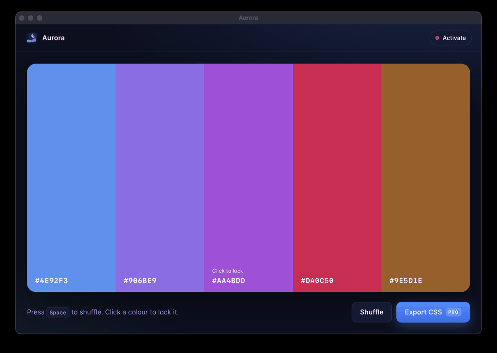
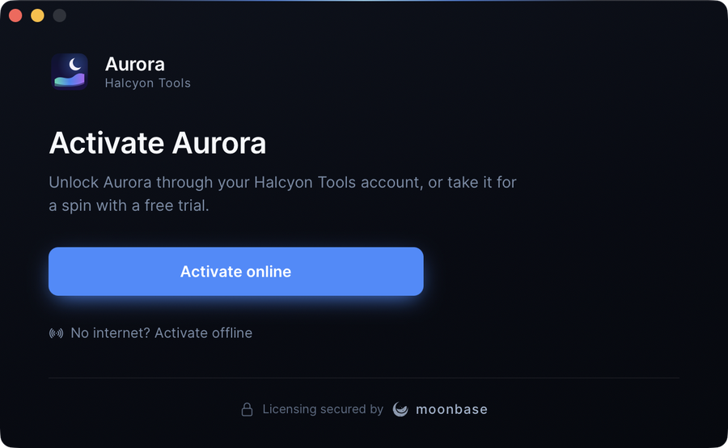

# Aurora: a Tauri example

A small palette generator whose export is a paid feature, licensed through Moonbase
with [`tauri-plugin-moonbase`](../../crates/tauri-plugin-moonbase/). It is wired to
Moonbase's public demo store (`demo.moonbase.sh`, product `demo-app`), so it activates
out of the box: start a trial or activate in the browser that opens.

<p align="center">
  
  
</p>

## Run it

```sh
# from the repository root; needs the Tauri prerequisites for your OS
cargo run -p aurora

# or with the Tauri CLI, for hot reload of the frontend
cd examples/tauri-app
npm install
npm run dev
```

With no license, the activation window opens by itself. To see the other option, the
activation screen locking the main window until the app is licensed, run it with
`AURORA_PRESENTATION=overlay`:

```sh
AURORA_PRESENTATION=overlay cargo run -p aurora
```

 The license is kept in the
app's data directory (`~/Library/Application Support/sh.moonbase.examples.aurora/` on
macOS); use **Deactivate this device** in the license window, or delete `license.mb`,
to start over.

## What to look at

| File | What it shows |
| --- | --- |
| [`src-tauri/src/lib.rs`](src-tauri/src/lib.rs) | Registering the plugin, branding its activation UI (name, maker, accent, logo, trial features), choosing between a window and a locking overlay, and gating `export_palette` in Rust with `app.moonbase().is_licensed()`, presenting the UI when unlicensed |
| [`src-tauri/capabilities/default.json`](src-tauri/capabilities/default.json) | `moonbase:default`, for the badge's calls; the activation window grants itself its own |
| [`src/main.js`](src/main.js) | The app, plus a license badge that follows the state event and opens the window |

The frontend has no build step: it uses `window.__TAURI__.moonbase`, which the plugin
provides when `withGlobalTauri` is on.

## Use your own store

Replace `MOONBASE_ENDPOINT`, `MOONBASE_PRODUCT_ID` and `moonbase-public-key.pem` in
`src-tauri` with your store, product id and the product's public key from the Moonbase
dashboard.
